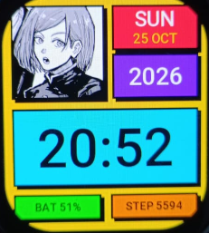

<div align="center">

# ▛▀▀▀▀▀▀▀▀▀▀▀▀▀▀▀▀▀▀▀▀▀▀▀▀▜
# BRUTALISM × JJK
# ▙▄▄▄▄▄▄▄▄▄▄▄▄▄▄▄▄▄▄▄▄▄▄▄▄▟

**HARD EDGES. LOUD COLORS. NOBARA ON YOUR WRIST.**


<br>



<br>

</div>

---

## ■ WHAT IS THIS

A watchface for the **Amazfit Bip 6** (390×450) with a **neo-brutalist** look:
flat color blocks, thick black borders, hard offset shadows, zero gradients.
The anime part is **Kugisaki Nobara** (*Jujutsu Kaisen*), drawn in manga ink.

No soft stuff. No blur. No rounded corners. Just blocks.

---

## ■ WHAT IT SHOWS

| BLOCK | COLOR | DATA |
|:------|:------|:-----|
| 🖼 PORTRAIT | `WHITE` | Nobara, manga style |
| 🟥 DAY + DATE | `#FF3B4E` | `SUN` / `25 OCT` |
| 🟪 YEAR | `#7B2FF7` | `2026` |
| 🟦 TIME | `#00E5FF` | `HH:MM`, updates every minute |
| 🟩 BATTERY | `#39FF14` | `BAT 51%` |
| 🟧 STEPS | `#FF8A00` | `STEP 5594` |

Background: `#FFD60A` (hat-band yellow). Everything is outlined in `#000000`.

---

## ■ PALETTE

| NAME | HEX |
|:-----|:----|
| 🟨 YELLOW | `#FFD60A` |
| 🟥 RED | `#FF3B4E` |
| 🟦 CYAN | `#00E5FF` |
| 🟪 VIOLET | `#7B2FF7` |
| 🟩 GREEN | `#39FF14` |
| 🟧 ORANGE | `#FF8A00` |
| ⬛ BLACK | `#000000` |
| ⬜ WHITE | `#FFFFFF` |

---

## ■ PROJECT STRUCTURE

```
brutalism-anime/
├── app.js                  # app entry
├── app.json                # Zepp OS manifest (target: 390x450-amazfit-bip-6)
├── watchface/
│   └── index.js            # ALL the UI lives here
├── shared/                 # polyfills + helpers (from template)
├── assets/
│   └── 390x450-amazfit-bip-6/
│       ├── icon.png
│       └── portrait.png    # Nobara, 170x170
└── docs/
    └── preview.png         # screenshot used in this README
```

The look is built from two helpers in [`watchface/index.js`](watchface/index.js):

- `block(x, y, w, h, color)` draws shadow + border + fill.
- `label(x, y, w, h, size, color, text)` draws centered text.

Change the layout by editing the coordinates in `build()`.

---

## ■ RUN IT

You need the Zepp OS tooling (**Zeus CLI**) and a Bip 6 or the Zepp simulator.

```bash
# install the CLI
npm i -g @zeppos/zeus-cli

# from the project root
zeus preview     # QR code, install on your watch via Zepp app
zeus build       # produces a .zab package in dist/
```

> `dist/` and `*.bak` are git-ignored.

---

## ■ TODO

- [x] Rename app from `Empty` to `Brutalism JJK` in `app.json`
- [ ] Color tint on the portrait
- [ ] Always-on display (AOD) version
- [ ] More JJK characters

---

## ■ CREDITS

- Character: **Kugisaki Nobara** © Gege Akutami / Shueisha / MAPPA. Fan work, not affiliated.
- Artwork in the portrait belongs to its original artist.

<div align="center">

**━━━━━━━━━━━━━━━━━━━━━━━━━━━━━━━━**
**BUILT LOUD. READ THE TIME. MOVE ON.**
**━━━━━━━━━━━━━━━━━━━━━━━━━━━━━━━━**

</div>
